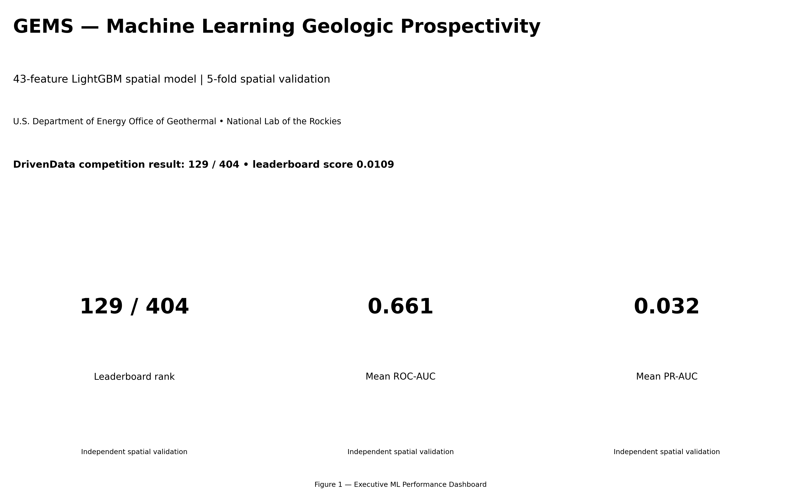

# 🌎 Geologic Enhanced Mapping System (GEMS)

### AI-Assisted Fault Discovery • Geospatial Intelligence • Geothermal Exploration

<p align="center">
  
</p>

<p align="center">
  <strong>From geophysical evidence to geologically informed exploration targets.</strong>
</p>

<p align="center">
  
  
  
  
</p>

**Geologic Enhanced Mapping System (GEMS)** is a reproducible geospatial machine-learning research portfolio focused on identifying and prioritizing potential geological fault structures across Nevada and adjacent eastern California.

The project integrates geophysical predictors, terrain information, structural context, and machine-learning-based prospectivity scoring to help prioritize areas for geological interpretation and potential geothermal exploration.

Rather than treating any individual raster or anomaly as definitive evidence of a fault, GEMS creates a continuous spatial ranking surface that can support expert review, comparative mapping, and follow-up investigation.

> **Research principle:** AI should help geologists discover where to look next—not replace geological evidence, field validation, or expert judgment.

---

## 📑 Table of Contents

* [Project Overview](#-project-overview)
* [Executive Dashboard](#-executive-dashboard)
* [Key Results](#-key-results)
* [Explore the Maps](#-explore-the-maps)
* [Terrain and DEM Analysis](#-terrain-and-dem-analysis)
* [Geophysical Evidence](#-geophysical-evidence)
* [Model Diagnostics](#-model-diagnostics)
* [Data Portfolio](#-data-portfolio)
* [Methodology](#-methodology)
* [Understanding the DWT Metric](#-understanding-the-distance-weighted-tversky-metric)
* [Reproducibility and Validation](#-reproducibility-and-validation)
* [Repository Structure](#-repository-structure)
* [Research Roadmap](#-research-roadmap)
* [Limitations and Responsible Interpretation](#-limitations-and-responsible-interpretation)
* [Scientific Background](#-scientific-background)
* [Acknowledgements](#-acknowledgements)

---

## 🔬 Project Overview

Geothermal exploration depends on the interaction of heat, fluids, and connected permeability. Faults and other geological structures may influence fluid circulation, but their effects depend on local geology, structural history, mineralization, and stress conditions.

Many potentially relevant structures are incompletely mapped, concealed beneath sediments, or difficult to distinguish from non-tectonic lineaments.

GEMS investigates how multiple sources of spatial evidence can be combined to prioritize locations that deserve further geological examination.

### Research objectives

| Objective                            | Approach                                                                               |
| ------------------------------------ | -------------------------------------------------------------------------------------- |
| Integrate heterogeneous evidence     | Combine 20 base geophysical bands with derived and contextual predictors               |
| Identify fault-like spatial patterns | Train a LightGBM gradient-boosted decision-tree model                                  |
| Prioritize candidate locations       | Generate a continuous prospectivity score surface                                      |
| Evaluate spatial agreement           | Examine ROC-AUC, PR-AUC, and distance-weighted Tversky diagnostics                     |
| Support interpretation               | Visualize prediction maps, terrain context, geophysical signatures, and ranked targets |
| Improve reproducibility              | Preserve CSV artifacts, evaluation summaries, and geospatial metadata                  |

### Intended application

The principal use case is **decision support for geological fault mapping and geothermal exploration**. The same general approach may be useful in other geoscience applications where incomplete labels and heterogeneous spatial data complicate interpretation.

The repository documents a research workflow and its archived results; it does not establish that every high-scoring location contains a previously unknown fault or a commercially viable geothermal resource.

---

## 🖥️ Executive Dashboard

The following indicators summarize the currently archived portfolio. They are research diagnostics, not official competition leaderboard results.

| Indicator                   | Archived value |
| --------------------------- | -------------: |
| Machine-learning model      |       LightGBM |
| Total predictors            |             43 |
| Base geophysical bands      |             20 |
| Raster width                |    3,292 cells |
| Raster height               |    3,730 cells |
| Nominal output resolution   |          100 m |
| Coordinate reference system |     EPSG:32611 |
| Finite prediction pixels    |      4,733,111 |
| Valid prediction coverage   |         38.55% |
| Mean ROC-AUC                |         0.6612 |
| Mean PR-AUC                 |         0.0318 |
| Mean probabilistic DWT      |         0.0616 |
| Mean best hard DWT          |         0.1148 |

**Source:** [`Tables/GEMS_portfolio_summary.csv`](Tables/GEMS_portfolio_summary.csv) and [`Tables/prediction_summary.csv`](Tables/prediction_summary.csv).

### What these numbers tell us

* **43 predictors:** the model combines base geophysical information with derived or contextual features.
* **100 m nominal grid:** the output is represented on a fine spatial grid, but the effective resolution is constrained by the source data.
* **38.55% valid coverage:** a substantial portion of the full grid does not contain finite predictions. Uncovered areas must be treated as missing data, not as low prospectivity.
* **ROC-AUC of 0.6612:** the recorded evaluation indicates modest discrimination between labeled positives and negatives under the archived evaluation design.
* **PR-AUC of 0.0318:** precision–recall performance must be interpreted in the context of class prevalence, label completeness, and sampling design.

These metrics are useful baselines. Stronger claims about generalization require documented spatially independent validation and a verified evaluation implementation.

---

## 🗺️ Explore the Maps

The repository contains visual artifacts for examining model predictions at multiple scales, from broad prospectivity patterns to candidate locations.

### 1. Regional prediction surface

<p align="center">
  
</p>

**Figure 1. Regional GEMS prediction map.** The spatial prediction surface provides an overview of how the model ranks locations across the available grid.

Explore: [`02_GEMS_prediction_map.png`](Figures/02_GEMS_prediction_map.png)

### 2. Geological prospectivity

<p align="center">
  
</p>

**Figure 2. Prospectivity score surface.** Higher scores indicate stronger agreement with patterns learned from the training labels. They are ranking signals rather than calibrated probabilities of fault existence.

Explore: [`02_GEMS_prospectivity_map.png`](Figures/02_GEMS_prospectivity_map.png)

### 3. Prospectivity with geological linework

<p align="center">
  
</p>

**Figure 3. Geological context overlay.** Comparing the prediction surface with geological linework helps identify areas of agreement, potential extensions, and locations that warrant additional interpretation.

Explore: [`02_prospectivity_geologic_lines.png`](Figures/02_prospectivity_geologic_lines.png)

### 4. Satellite-context visualization

<p align="center">
  
</p>

**Figure 4. Prospectivity overlay in landscape context.** Surface imagery can help an interpreter distinguish possible structural expressions from drainage, roads, erosional boundaries, and other linear features.

Explore: [`01_satellite_prospectivity_overlay.png`](Figures/01_satellite_prospectivity_overlay.png)

### 5. Ranked exploration targets

<p align="center">
  
</p>

**Figure 5. High-ranking prospectivity targets.** Ranked locations provide a starting point for examining spatial continuity, structural intersections, geophysical support, and independent geological evidence.

Explore: [`07_top_prospectivity_targets.png`](Figures/07_top_prospectivity_targets.png)

**Interpretation note:** A high-ranking target is a hypothesis to investigate, not a confirmed new fault or a validated geothermal prospect.

---

## ⛰️ Terrain and DEM Analysis

Digital elevation models (DEMs) provide an important source of geomorphic context. Fault-related surface expressions can include scarps, aligned valleys, slope breaks, linear ridges, offset drainage, and abrupt changes in landform orientation.

These expressions are not unique to faulting. Erosion, lithological boundaries, drainage networks, and human-made features can produce similar patterns.

<p align="center">
  
</p>

**Figure 6. DEM hillshade and contour context.** Terrain illumination and contour patterns help reveal landform breaks and potential lineaments for further geological inspection.

Explore: [`05_dem_hillshade_contours.png`](Figures/05_dem_hillshade_contours.png)

### Terrain features of interest

| Terrain evidence     | Potential interpretation                         | Important caveat                                                 |
| -------------------- | ------------------------------------------------ | ---------------------------------------------------------------- |
| Hillshade lineaments | Linear terrain breaks or aligned landforms       | Illumination direction can create or hide apparent edges         |
| Slope gradients      | Scarps and abrupt terrain transitions            | Erosion and lithological contrasts can produce similar gradients |
| Curvature            | Changes in terrain form                          | Sensitive to noise and DEM resolution                            |
| Local relief         | Contrasts between elevated and low-lying terrain | Depends on neighborhood scale                                    |
| Contour patterns     | Changes in slope and landform geometry           | Not direct evidence of subsurface faulting                       |

### Why multi-source terrain analysis matters

A DEM can reveal surface expression that is weak in a geophysical layer, while geophysical gradients may highlight structures concealed at the surface.

The most useful interpretation comes from comparing independent evidence rather than assuming that any single derivative is diagnostic.

---

## 🧲 Geophysical Evidence

The model's feature portfolio includes 20 base geophysical bands and a reported total of 43 predictors.

The archived inventory includes categories of geophysical and contextual information such as magnetic and gravity products, derivatives, radiometric or related variables, deformation-rate information, conductivity, depth-to-basement-related information, and elevation. The precise meaning, units, provenance, and processing history of individual bands should be confirmed against the original feature metadata.

<p align="center">
  
</p>

**Figure 7. Geophysical signatures associated with model predictions.** Comparing feature behavior around high-ranking locations can help investigate whether the model relies on plausible geological contrasts or potentially confounding patterns.

Explore: [`03_GEMS_geophysical_signatures.png`](Figures/03_GEMS_geophysical_signatures.png)

### Complementary evidence

* **Magnetic anomalies and gradients:** may highlight contrasts in magnetic properties, geological contacts, and structural boundaries.
* **Gravity anomalies and derivatives:** may reveal variations in subsurface density and regional geological structure.
* **Conductivity-related information:** can contribute evidence about subsurface electrical properties.
* **Terrain and elevation:** describe surface morphology and potential geomorphic expression.
* **Derived features:** can emphasize local contrasts and interactions between source variables.

These signals are not unique to faulting. Geological interpretation must account for lithology, acquisition and processing artifacts, resolution differences, and correlations among predictors.

---

## 📈 Model Diagnostics

Model performance is only one component of an enhanced mapping workflow. Threshold sensitivity, spatial agreement, feature behavior, and the concentration of false positives all affect whether predictions are useful to a geological reviewer.

### Distance-weighted Tversky diagnostics

<p align="center">
  
</p>

**Figure 8. Distance-weighted Tversky diagnostics.** The archived plot provides a view of the distance-weighted evaluation behavior.

Explore: [`03_distance_weighted_tversky.png`](Figures/03_distance_weighted_tversky.png)

### Spatial contribution diagnostics

<p align="center">
  
</p>

**Figure 9. Distance-weighted Tversky heatmap.** Spatial diagnostics can help identify where agreement and disagreement with reference labels contribute to the evaluation.

Explore: [`03_distance_weighted_tversky_heatmap.png`](Figures/03_distance_weighted_tversky_heatmap.png)

### Spatial score map

<p align="center">
  
</p>

**Figure 10. Spatial evaluation map.** The mapped evaluation artifact complements scalar metrics by providing a spatial view of score-related contributions.

Explore: [`04_distance_weighted_tversky_map.png`](Figures/04_distance_weighted_tversky_map.png)

### Feature-signature diagnostics

<p align="center">
  
</p>

**Figure 11. Model feature signatures.** Feature importance and feature signatures describe model behavior; they do not establish causal geological controls.

Explore: [`08_model_feature_signatures.png`](Figures/08_model_feature_signatures.png)

### Understanding the archived metrics

The repository records several evaluation summaries that must remain distinct:

| Metric                 | Recorded value | Interpretation                                               |
| ---------------------- | -------------: | ------------------------------------------------------------ |
| Mean ROC-AUC           |         0.6612 | Discrimination under the archived evaluation design          |
| Mean PR-AUC            |         0.0318 | Precision–recall behavior under the archived sampling design |
| Mean probabilistic DWT |         0.0616 | Recorded probabilistic evaluation summary                    |
| Mean best hard DWT     |         0.1148 | Recorded fold-level best hard-threshold summary              |
| Separate DWT summary   |         0.2502 | A separate weighted-contribution calculation                 |

The separate DWT value of approximately 0.2502 is documented in [`Tables/distance_weighted_tversky_summary.csv`](Tables/distance_weighted_tversky_summary.csv). It is not interchangeable with the mean probabilistic or fold-level hard-threshold results.

Differences in aggregation, thresholding, evaluated predictions, or evaluation context can lead to different scores. The archived notebook and scoring implementation should be consulted before comparing these results or reporting an official competition score.

---

## 📂 Data Portfolio

The `Tables/` directory contains the project's archived CSV artifacts. These are intended to support inspection, comparison, reporting, and reproducibility.

### Core summary datasets

| File                                                                                    | Purpose                                                              |
| --------------------------------------------------------------------------------------- | -------------------------------------------------------------------- |
| [`GEMS_portfolio_summary.csv`](Tables/GEMS_portfolio_summary.csv)                       | Model configuration, recorded metrics, grid dimensions, and coverage |
| [`prediction_summary.csv`](Tables/prediction_summary.csv)                               | Prediction raster statistics, valid pixels, range, and CRS           |
| [`model_performance.csv`](Tables/model_performance.csv)                                 | Fold-level threshold diagnostics and weighted contributions          |
| [`distance_weighted_tversky_summary.csv`](Tables/distance_weighted_tversky_summary.csv) | Aggregated DWT contributions and metric parameters                   |

### Feature and input datasets

| File                                                          | Purpose                             |
| ------------------------------------------------------------- | ----------------------------------- |
| [`feature_statistics.csv`](Tables/feature_statistics.csv)     | Feature-level statistical summaries |
| [`selected_input_files.csv`](Tables/selected_input_files.csv) | Inventory of selected input files   |

### Target-ranking and evaluation datasets

| File                                                                            | Purpose                                                |
| ------------------------------------------------------------------------------- | ------------------------------------------------------ |
| [`prospectivity_cells.csv`](Tables/prospectivity_cells.csv)                     | Archived cell-level prospectivity data                 |
| [`top_100_prospectivity_targets.csv`](Tables/top_100_prospectivity_targets.csv) | Ranked high-prospectivity target records               |
| [`threshold_analysis.csv`](Tables/threshold_analysis.csv)                       | Threshold sensitivity analysis                         |
| [`dwt_pixel_contributions.csv`](Tables/dwt_pixel_contributions.csv)             | Pixel-level distance-weighted evaluation contributions |

Browse all artifacts in the [Tables directory](Tables/).

**Important:** The repository includes archived summaries and analytical outputs, but the presence of a CSV does not by itself establish that its contents were produced by a fully independent validation process. Refer to the generating notebook and data provenance when making scientific claims.

---

## ⚙️ Methodology

The research workflow can be summarized in six stages.

### Stage 1 — Spatial data preparation

* Inventory the available input rasters and tabular artifacts.
* Check coordinate reference systems, dimensions, transforms, bounds, and NoData masks.
* Align compatible rasters to a common analysis grid.
* Preserve original units and document resampling choices.
* Distinguish missing coverage from physically meaningful zero values.

### Stage 2 — Feature engineering

* Assemble the base geophysical predictors.
* Incorporate terrain and structural context where supported by available data.
* Derive local gradients, neighborhood statistics, and other contextual predictors when justified.
* Examine correlated variables and potential noise amplification.
* Record feature definitions, units, and provenance.

### Stage 3 — Model fitting

The archived portfolio uses LightGBM, a gradient-boosted decision-tree model suited to nonlinear interactions among heterogeneous tabular features.

The model learns statistical associations with the available training labels. It does not inherently understand geological topology, fault continuity, or the physical causes of geophysical anomalies.

### Stage 4 — Evaluation

The recorded evaluation portfolio includes:

* ROC-AUC;
* precision–recall AUC;
* distance-weighted Tversky diagnostics;
* fold-specific threshold analysis;
* weighted true-positive, false-positive, and false-negative contributions.

Spatially blocked validation is recommended to evaluate transfer to geographically distinct areas. The available summary values alone do not establish that the recorded folds were fully independent.

### Stage 5 — Prediction and mapping

The archived prediction output is described as a floating-point score raster with:

* **Width:** 3,292 cells;
* **Height:** 3,730 cells;
* **Nominal resolution:** 100 m;
* **CRS:** EPSG:32611;
* **Finite pixels:** 4,733,111.

These metadata describe the archived output. Before any formal submission, the actual raster should be checked against the competition's required template, including its transform, bounds, data type, NoData representation, and valid-value range.

### Stage 6 — Geological interpretation

Ranked candidates should be examined for:

* spatial continuity and orientation;
* consistency across independent geophysical layers;
* terrain expression and geomorphic plausibility;
* relation to known geological structures;
* alternative explanations such as lithological contacts or drainage;
* stability across folds, models, and feature perturbations.

The output is a prioritization layer for further investigation, not an autonomous fault inventory.

---

## 🎯 Understanding the Distance-Weighted Tversky Metric

A conventional Tversky index is written as

$$
T_{\alpha,\beta}
=
\frac{TP}
{TP+\alpha FP+\beta FN},
$$

where \(TP\), \(FP\), and \(FN\) represent true-positive, false-positive, and false-negative contributions.

The archived portfolio records a 300 m tolerance, equivalent to three nominal 100 m pixels, with \(\alpha=0.2\) and \(\beta=0.8\).

In the distance-weighted version, spatial proximity modifies the evaluation contributions according to the applicable scoring procedure. The exact competition metric implementation must be used for official comparisons.

### Why distance weighting matters

A predicted structure can be geologically plausible even when its pixels do not align perfectly with a reference line. Distance-aware evaluation can recognize spatial proximity that strict pixel-by-pixel agreement would penalize.

However, a broad region of high scores can also create an excessive false-positive burden. A useful mapping system must balance recall, spatial specificity, and practical interpretability.

### Archived weighted-contribution summary

| Quantity                                       | Recorded value |
| ---------------------------------------------- | -------------: |
| Weighted true-positive contribution, \(TP_w\)  |      26,283.97 |
| Weighted false-positive contribution, \(FP_w\) |     255,000.52 |
| Weighted false-negative contribution, \(FN_w\) |      34,704.00 |
| \(\alpha\)                                     |            0.2 |
| \(\beta\)                                      |            0.8 |
| Distance tolerance                             |          300 m |
| Nominal tolerance in pixels                    |              3 |
| Separately recorded DWT                        |         0.2502 |

Source: [`distance_weighted_tversky_summary.csv`](Tables/distance_weighted_tversky_summary.csv).

These values describe the archived weighted-contribution summary. They should not be substituted for the separate fold-level probabilistic and hard-threshold averages.

---

## 🔁 Reproducibility and Validation

The goal is to make the research auditable, not merely visually compelling.

### Recommended validation checklist

* [ ] Preserve the original input-file inventory.
* [ ] Record software versions, model parameters, and random seeds.
* [ ] Document feature definitions, units, transformations, and source resolution.
* [ ] Verify spatial fold geometries and geographic separation.
* [ ] Fit preprocessing and feature selection using training data only within each fold.
* [ ] Perform threshold selection without using held-out evaluation labels.
* [ ] Reproduce the distance-weighted metric on controlled test examples.
* [ ] Report per-fold metrics, positive prevalence, and uncertainty.
* [ ] Compare geophysics-only, terrain-only, and combined feature sets.
* [ ] Validate prediction raster dimensions, CRS, transform, NoData, and value range.
* [ ] Keep the exact prediction set and evaluation context attached to each reported score.
* [ ] Record checksums and versions for released artifacts.

### Suggested experiment matrix

| Experiment                     | Purpose                                                          |
| ------------------------------ | ---------------------------------------------------------------- |
| Geophysics-only                | Establish the baseline contribution of base geophysical features |
| Terrain-only                   | Assess the value of DEM-derived evidence                         |
| Combined predictors            | Measure the value of integrating evidence sources                |
| Combined with derived features | Test whether local gradients and context improve ranking         |
| Spatially blocked validation   | Estimate transfer to unseen geographic regions                   |
| Threshold sensitivity          | Quantify the recall–false-positive trade-off                     |
| Model ensemble                 | Examine prediction stability across models or folds              |
| Geological candidate review    | Test whether high-ranking locations are independently plausible  |

These are recommended follow-up experiments, not claims that every experiment has already been completed.

---

## 🗂️ Repository Structure

```text
GeologicEnhancedMap/
├── README.md
├── Figures/
│   ├── 01_GEMS_executive_dashboard.png
│   ├── 01_satellite_prospectivity_overlay.png
│   ├── 02_GEMS_prediction_map.png
│   ├── 02_GEMS_prospectivity_map.png
│   ├── 02_prospectivity_geologic_lines.png
│   ├── 03_GEMS_geophysical_signatures.png
│   ├── 03_distance_weighted_tversky.png
│   ├── 03_distance_weighted_tversky_heatmap.png
│   ├── 04_distance_weighted_tversky_map.png
│   ├── 05_dem_hillshade_contours.png
│   ├── 07_top_prospectivity_targets.png
│   └── 08_model_feature_signatures.png
└── Tables/
    ├── GEMS_portfolio_summary.csv
    ├── distance_weighted_tversky_summary.csv
    ├── dwt_pixel_contributions.csv
    ├── feature_statistics.csv
    ├── model_performance.csv
    ├── prediction_summary.csv
    ├── prospectivity_cells.csv
    ├── selected_input_files.csv
    ├── threshold_analysis.csv
    └── top_100_prospectivity_targets.csv
```

The tree reflects the files documented in the current repository inventory. Additional notebooks, model files, or raster outputs should be added to this listing only if they are actually committed to the repository.

---

## 🚀 Research Roadmap

The next phase should focus on scientific validity and the practical usefulness of the ranked targets.

### Priority 1 — Verify evaluation integrity

Reproduce the official distance-weighted metric, reconcile the distinct DWT summaries, and establish exactly which predictions, folds, and thresholds generated each result.

### Priority 2 — Strengthen spatial generalization

Use geographic blocks or structurally distinct regions for validation. Document fold boundaries and compare performance across regions with different geological and data-coverage characteristics.

### Priority 3 — Quantify the value of each evidence source

Run controlled feature ablations to establish whether terrain, geophysical derivatives, and neighborhood context improve performance beyond the base predictors.

### Priority 4 — Improve target geometry

Investigate whether spatial continuity, orientation, structural intersections, and candidate-segment ranking improve the usefulness of the prediction surface without introducing excessive false positives.

### Priority 5 — Characterize uncertainty

Compare fold-level predictions, alternative model specifications, and input perturbations. Separate stable high-ranking candidates from locations whose rankings depend strongly on the modeling choices.

### Priority 6 — Validate candidates independently

Compare selected targets against independent geological maps, source geophysical products, remote-sensing context, and field observations where available.

The strongest next result would not simply be a higher scalar score. It would be a demonstrably more reliable and interpretable set of candidate structures.

---

## ⚠️ Limitations and Responsible Interpretation

**Incomplete labels.** An unlabeled location is not necessarily a true geological negative. Unmapped faults can be present in areas classified as background.

**Spatial dependence.** Nearby pixels share geological and geophysical structure. Random pixel splits can overstate generalization.

**Coverage gaps.** Approximately 38.55% of the recorded grid has finite predictions. Missing coverage must remain explicit in all maps and downstream analysis.

**Resolution mismatch.** A 100 m output grid does not mean that every source dataset provides independent information at 100 m resolution.

**Lineament ambiguity.** Roads, drainage, lithological boundaries, erosional features, and processing artifacts can resemble faults.

**Model interpretation.** Feature importance measures model reliance under a particular dataset and model specification; it does not establish geological causation.

**Metric comparability.** Results from different folds, thresholds, aggregation methods, or evaluation implementations should not be presented as interchangeable.

**Geothermal inference.** A potential fault structure does not establish reservoir temperature, fluid availability, permeability, sustainable production, or commercial viability.

The appropriate use of GEMS is to help prioritize geological investigation while preserving uncertainty and independent verification.

---

## 📚 Scientific Background

The project is motivated by the intersection of geothermal structural geology, remote sensing, geophysical interpretation, and machine learning.

Selected background references:

1. Ahmadi, H., and Pekkan, E. (2021). *Fault-based geological lineaments extraction using remote sensing and GIS—a review.* Geosciences, 11(5), 183. https://doi.org/10.3390/geosciences11050183

2. Faulds, J. E., Hinz, N. H., Coolbaugh, M. F., et al. (2021). *Geological controls on geothermal resources for power generation.* Nature Reviews Earth & Environment, 2, 324–339. https://doi.org/10.1038/s43017-021-00154-y

3. van der Meer, F. D., Hecker, C. A., van Ruitenbeek, F. J., et al. (2014). *Geologic remote sensing for geothermal exploration: A review.* International Journal of Applied Earth Observation and Geoinformation, 33, 255–269. https://doi.org/10.1016/j.jag.2014.05.007

4. U.S. Department of Energy, Geothermal Technologies Office. (2026). *Office of Geothermal Announces Geologic Enhanced Mapping System (GEMS) Prize.* [Read the announcement](https://www.energy.gov/hgeo/geothermal/articles/office-geothermal-announces-geologic-enhanced-mapping-system-gems-prize).

These references provide scientific context; they should not be interpreted as independent validation of the results reported in this repository.

---

## 🙏 Acknowledgements

This research portfolio is framed around the Geologic Enhanced Mapping System (GEMS) Prize announced by the U.S. Department of Energy.

The project is an independent research effort and is not represented as endorsed by the Department of Energy, the National Lab of the Rockies, or DrivenData.

Author: **Umar Tabbsum**
Role: Independent Researcher
Research area: Geospatial machine learning, geological fault mapping, and geothermal exploration
Report date: October 2026

---

## ⭐ Closing Perspective

GEMS explores how geophysical measurements, terrain context, and machine learning can be combined to prioritize geological structures that deserve closer examination.

Its value depends not only on the sophistication of its model, but also on the quality of its spatial validation, the traceability of its data, the transparency of its uncertainty, and the geological defensibility of its candidate targets.

**The ultimate objective is to turn heterogeneous spatial data into reproducible geological hypotheses that experts can investigate and independently test.**

If you find this research useful, explore the figures and tables, reproduce the archived diagnostics, and build on the workflow with stronger spatial validation and independent geological verification.

<p align="center">
  <strong>Geologic Enhanced Mapping System (GEMS)</strong><br>
  <em>Mapping evidence. Ranking possibilities. Supporting discovery.</em>
</p>
