# Geologic Enhanced Mapping System (GEMS)

### Machine Learning and Distance-Weighted Mineral Prospectivity Mapping

GEMS (Geologic Enhanced Mapping System) integrates geophysical predictors, machine learning, geospatial visualization, and distance-weighted prospectivity evaluation to identify and rank potential geological exploration targets.

The project generates prospectivity maps, summarizes model performance, analyzes geophysical features, and preserves tabular and visual artifacts for reproducible analysis.

**Repository:** [ut1776/GeologicEnhancedMap](https://github.com/ut1776/GeologicEnhancedMap)

---

## Table of Contents

1. [Project Overview](#1-project-overview)
2. [Key Results and Score Summary](#2-key-results-and-score-summary)
3. [Study Grid and Data](#3-study-grid-and-data)
4. [Methodology](#4-methodology)
5. [Prediction Results](#5-prediction-results)
6. [Model Performance](#6-model-performance)
7. [Distance-Weighted Tversky Evaluation](#7-distance-weighted-tversky-evaluation)
8. [Prospectivity Maps](#8-prospectivity-maps)
9. [Exploration Target Ranking](#9-exploration-target-ranking)
10. [Feature and Geophysical Analysis](#10-feature-and-geophysical-analysis)
11. [Available Figures](#11-available-figures)
12. [Available CSV Tables](#12-available-csv-tables)
13. [Repository Structure](#13-repository-structure)
14. [Reproducibility](#14-reproducibility)
15. [Limitations and Future Work](#15-limitations-and-future-work)
16. [Conclusion](#16-conclusion)
17. [Citation](#17-citation)

---

## 1. Project Overview

Mineral prospectivity mapping uses geological, geophysical, and other spatial evidence to identify areas that warrant further exploration.

GEMS approaches this problem as a spatial prediction and target-prioritization task. Multiple predictor layers are integrated into a model-generated prospectivity surface. The resulting surface is analyzed, visualized, and used to rank candidate locations for further geological investigation.

The project includes:

* Geophysical predictor integration.
* Machine-learning prediction and spatial mapping.
* Prospectivity distribution statistics.
* Model-performance summaries.
* Distance-weighted Tversky diagnostics.
* High-prospectivity target ranking.
* Feature and geophysical-signature analysis.
* Exported PNG figures and CSV tables.

The repository preserves the archived outputs for inspection and further development.

## 2. Key Results and Score Summary

The archived GEMS analysis reports the following results.

| Metric                                       | Archived result |
| -------------------------------------------- | --------------: |
| Number of predictors                         |              43 |
| Base geophysical bands                       |              20 |
| Nominal raster resolution                    |           100 m |
| Finite prediction pixels                     |       4,733,111 |
| Finite-pixel coverage                        |          38.55% |
| Mean ROC-AUC                                 |          0.6612 |
| Mean PR-AUC                                  |          0.0318 |
| Mean probabilistic distance-weighted Tversky |          0.0616 |
| Mean best-hard distance-weighted Tversky     |          0.1148 |
| Separate archived summary score              |          0.2502 |
| Spatial tolerance                            |           300 m |
| Tversky alpha                                |             0.2 |
| Tversky beta                                 |             0.8 |

### GEMS score visualization

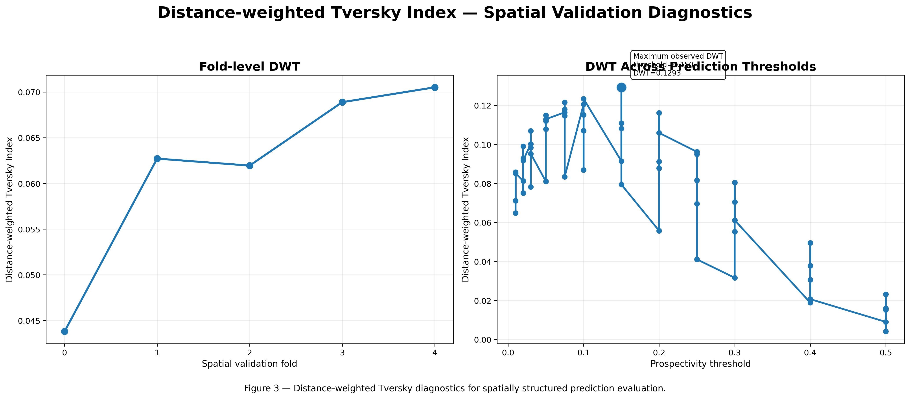

*Figure 1. Archived GEMS distance-weighted Tversky score visualization.*

The associated heatmap and spatial map are also available:

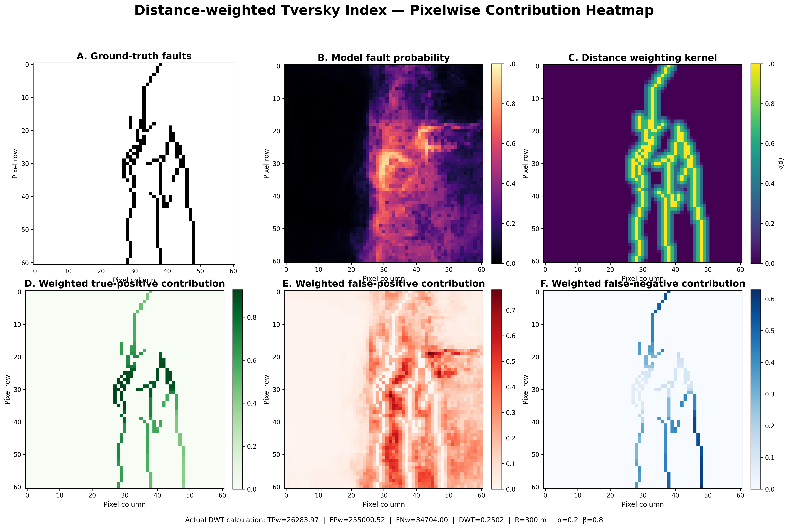

*Figure 2. Distance-weighted Tversky heatmap.*

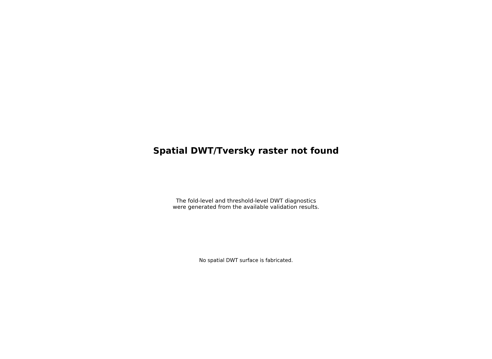

*Figure 3. Spatial visualization of distance-weighted Tversky analysis.*

**Important score distinction:** The archived values 0.0616, 0.1148, and 0.2502 represent separate reported diagnostics or summaries. They must not be presented as interchangeable scores. The exact meaning of each value should be confirmed against the code and CSV record that generated it.

The 0.2502 value is retained here because it appears in the archived portfolio summary. It should not be described as an official competition score unless the applicable scoring implementation confirms that interpretation.

## 3. Study Grid and Data

The archived prediction grid has the following characteristics:

| Property                    | Value        |
| --------------------------- | ------------ |
| Raster width                | 3,292 pixels |
| Raster height               | 3,730 pixels |
| Nominal resolution          | 100 m        |
| Coordinate reference system | EPSG:32611   |
| Number of predictors        | 43           |
| Base geophysical bands      | 20           |
| Finite prediction pixels    | 4,733,111    |
| Finite-pixel coverage       | 0.3855       |

Finite-pixel coverage describes the fraction of the nominal grid with valid predictions. It does not represent the percentage of the area containing mineral deposits.

The input layers should be checked for consistent spatial alignment, coordinate reference systems, resolution, NoData conventions, and data provenance before reproducing the analysis.

## 4. Methodology

The GEMS workflow can be summarized in the following stages.

1. **Input inventory:** identify selected source files and predictor layers.
2. **Spatial preparation:** prepare raster inputs on a consistent grid.
3. **Feature integration:** assemble the predictor variables.
4. **Model inference:** generate prospectivity predictions.
5. **Spatial visualization:** map prediction values and geophysical context.
6. **Feature analysis:** examine predictor distributions and feature signatures.
7. **Target ranking:** identify and rank high-prospectivity cells or targets.
8. **Evaluation:** review model-performance metrics and distance-weighted diagnostics.
9. **Artifact export:** preserve figures and CSV tables.

The precise model architecture, preprocessing operations, and training procedure should be verified against the associated source code and model artifacts.

## 5. Prediction Results

The archived prediction surface has the following reported distribution:

| Statistic          |    Value |
| ------------------ | -------: |
| Minimum            | 0.000063 |
| Median             |   0.0265 |
| Mean               |   0.0672 |
| Standard deviation |   0.1015 |
| Maximum            |   0.9344 |

The mean prediction exceeds the median, indicating that the prediction distribution is not symmetric and includes a subset of relatively high-valued cells.

These values describe the model's output distribution. They do not independently establish calibration, geological validity, or the probability of discovering an economic deposit.

The complete archived summary is available in [`prediction_summary.csv`](Tables/prediction_summary.csv).

### Prediction map

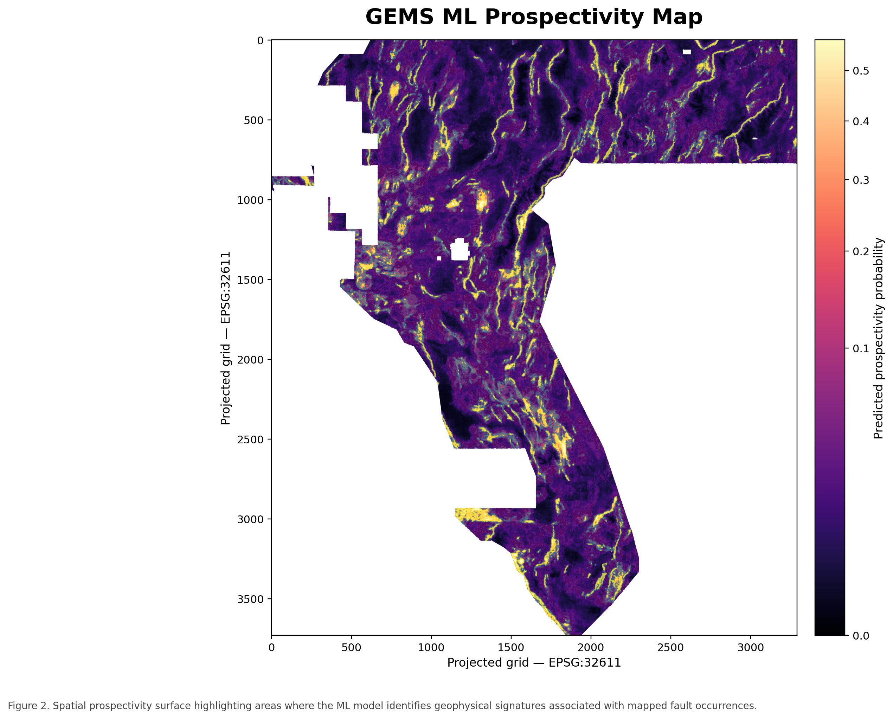

*Figure 4. GEMS prediction surface.*

## 6. Model Performance

The archived model-performance table reports:

| Metric  | Mean value |
| ------- | ---------: |
| ROC-AUC |     0.6612 |
| PR-AUC  |     0.0318 |

ROC-AUC measures ranking discrimination across classification thresholds. PR-AUC summarizes the precision-recall relationship and can be particularly sensitive to the prevalence of positive examples.

The values should be interpreted in the context of the validation dataset, class balance, spatial sampling strategy, and metric implementation.

A random split of spatially adjacent observations can overestimate generalization. Independent spatial validation is recommended when assessing whether the model transfers to new exploration areas.

See [`model_performance.csv`](Tables/model_performance.csv) for the archived metrics.

## 7. Distance-Weighted Tversky Evaluation

The conventional Tversky index is defined as:

$$
T_{\alpha,\beta}
=
\frac{TP}{TP+\alpha FP+\beta FN}
$$

where:

* \(TP\) represents the true-positive contribution.
* \(FP\) represents the false-positive contribution.
* \(FN\) represents the false-negative contribution.
* \(\alpha\) controls the penalty associated with false positives.
* \(\beta\) controls the penalty associated with false negatives.

The archived GEMS portfolio reports a spatial tolerance of **300 m**, equivalent to three nominal 100 m pixels, with the following parameters:

$$
\alpha = 0.2,\qquad \beta = 0.8
$$

The distance-weighted implementation modifies contributions according to spatial proximity. This allows the evaluation to account for the distance between predicted locations and reference targets.

### Archived evaluation diagnostics

| Diagnostic                                     | Reported value |
| ---------------------------------------------- | -------------: |
| Mean probabilistic distance-weighted Tversky   |         0.0616 |
| Mean best-hard distance-weighted Tversky       |         0.1148 |
| Separate archived summary score                |         0.2502 |
| Weighted true-positive contribution, \(TP_w\)  |      26,283.97 |
| Weighted false-positive contribution, \(FP_w\) |     255,000.52 |
| Weighted false-negative contribution, \(FN_w\) |      34,704.00 |

These figures are preserved as separate archived results. Their precise aggregation and implementation should be verified before comparing them with another model or benchmark.

### Evaluation figures


*Figure 5. Archived distance-weighted Tversky analysis.*


*Figure 6. Heatmap of the archived distance-weighted Tversky analysis.*


*Figure 7. Spatial representation of distance-weighted evaluation.*

### Evaluation data

* [`distance_weighted_tversky_summary.csv`](Tables/distance_weighted_tversky_summary.csv)
* [`dwt_pixel_contributions.csv`](Tables/dwt_pixel_contributions.csv)
* [`threshold_analysis.csv`](Tables/threshold_analysis.csv)

**Scoring caveat:** The conventional Tversky equation is provided for reference. Official competition comparisons must use the exact competition scoring implementation, including its matching procedure, distance weighting, tolerance, thresholds, and aggregation rules. An approximate substitute must not be represented as the official score.

## 8. Prospectivity Maps

The repository includes multiple visualizations of the prediction surface and its spatial context.

### Prospectivity map

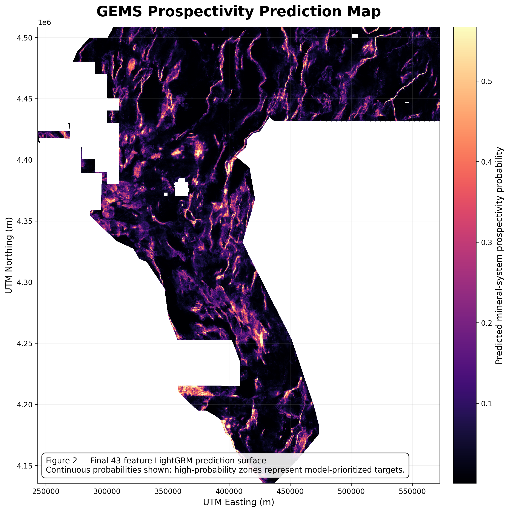

*Figure 8. GEMS prospectivity map.*

### Satellite overlay

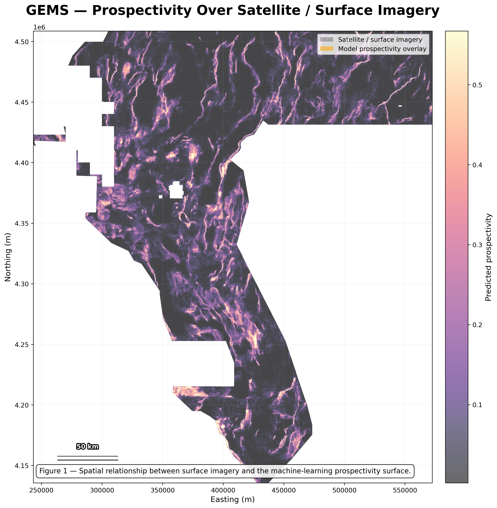

*Figure 9. Prospectivity predictions displayed with satellite or geographic context.*

### Prospectivity and geological lines

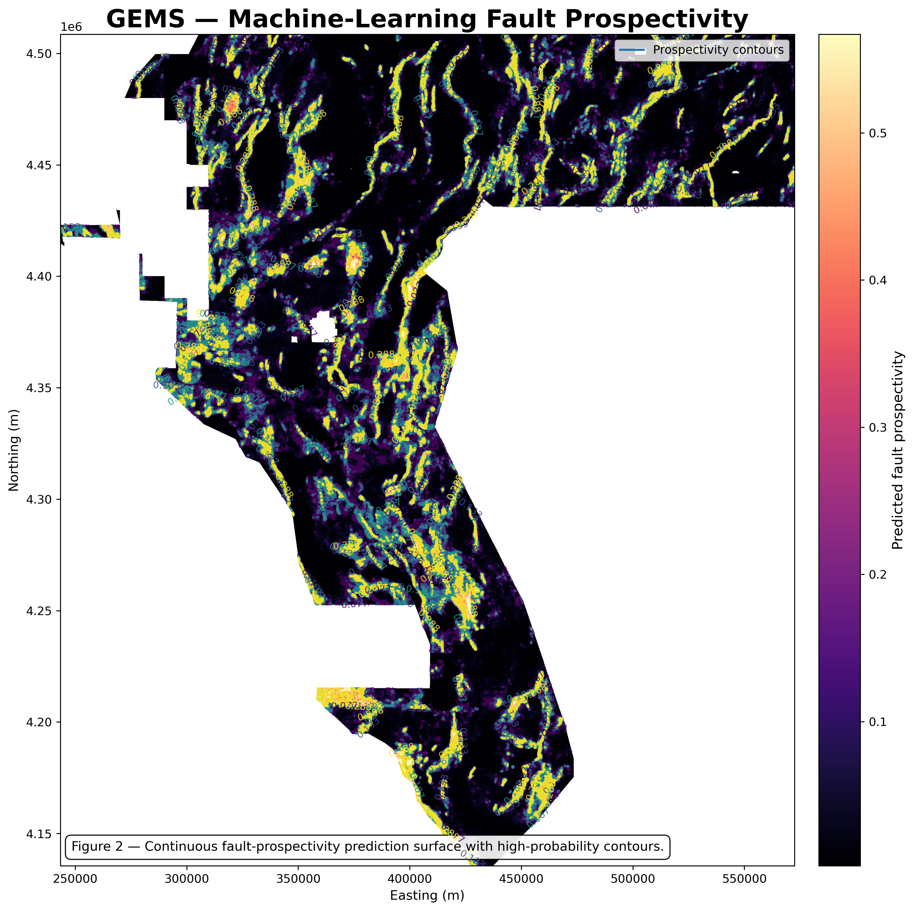

*Figure 10. Prospectivity patterns displayed with geological line context.*

### Digital elevation model, hillshade, and contours

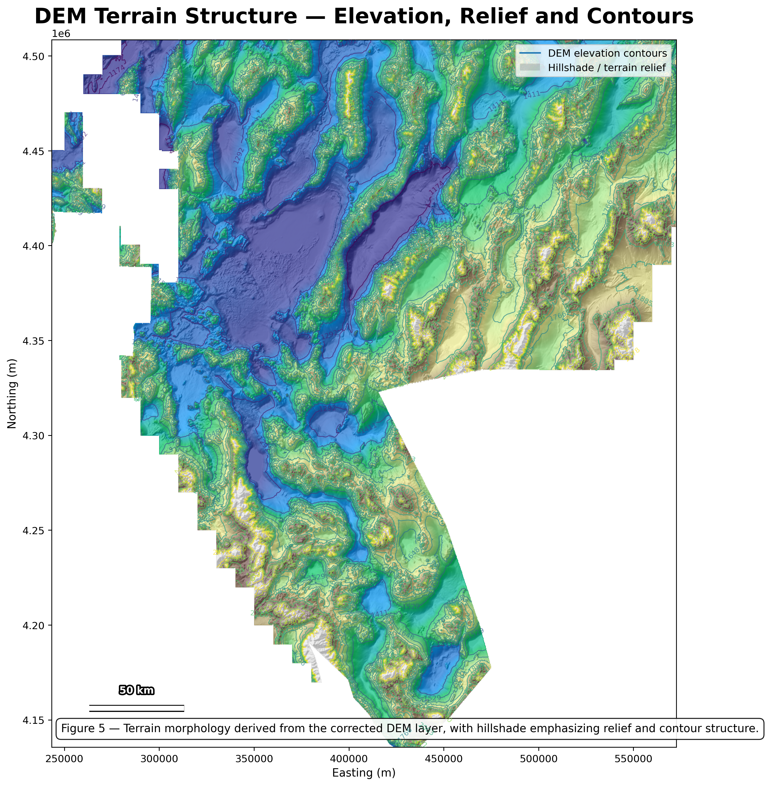

*Figure 11. Terrain visualization providing topographic context for spatial interpretation.*

These figures help users inspect spatial relationships among predictions, geographic features, and geological context. Visual agreement alone does not prove the presence of mineralization.

## 9. Exploration Target Ranking

GEMS includes a ranked list of high-prospectivity cells or candidate targets to help prioritize further geological review.

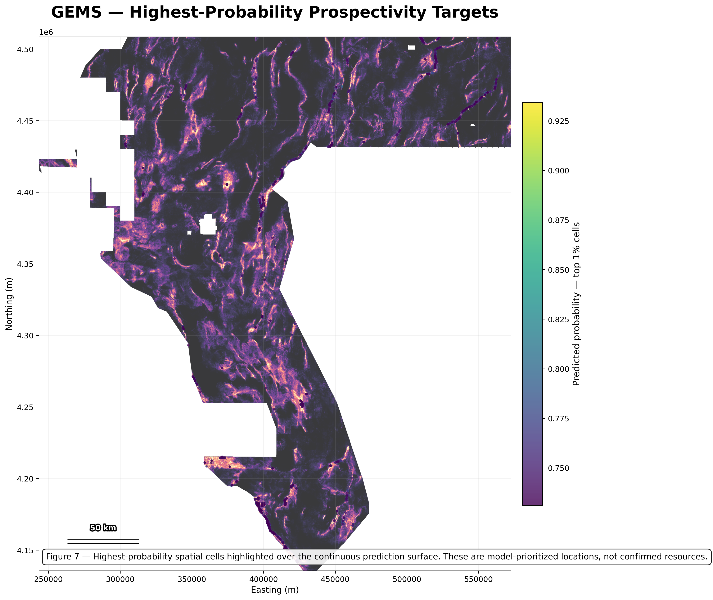

*Figure 12. Highest-ranked prospectivity targets in the archived GEMS analysis.*

The corresponding data are available in [`top_100_prospectivity_targets.csv`](Tables/top_100_prospectivity_targets.csv).

Target rankings should be interpreted as model-generated priorities rather than verified discoveries. Several nearby high-scoring cells may represent a single spatial target. Geological context, data quality, spatial clustering, and independent evidence should be considered before selecting locations for field investigation.

## 10. Feature and Geophysical Analysis

Feature analysis helps characterize the predictors and their spatial signatures.

### Geophysical signatures

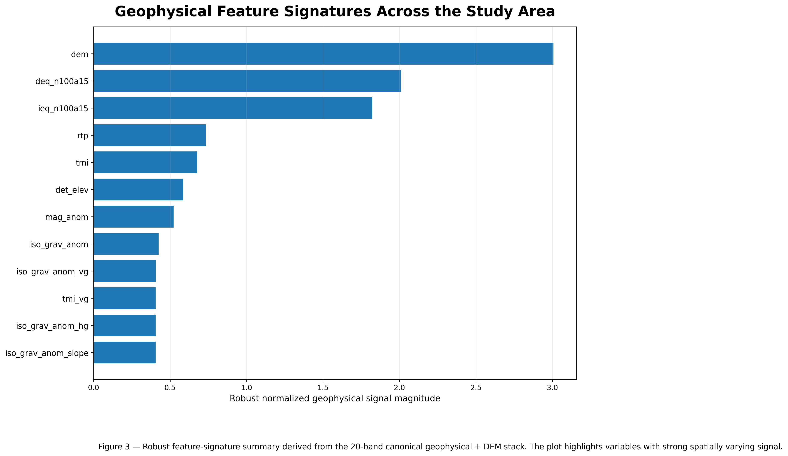

*Figure 13. Geophysical signatures associated with the GEMS predictor data.*

### Model feature signatures

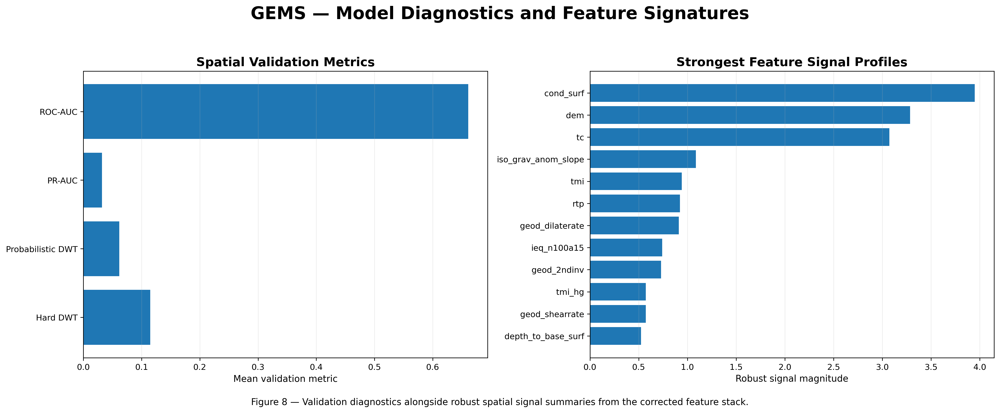

*Figure 14. Archived model feature-signature visualization.*

### Feature statistics

The complete feature-statistics table is available in [`feature_statistics.csv`](Tables/feature_statistics.csv).

Predictor statistics describe the input data but should not automatically be interpreted as model feature importance. Importance claims require a documented attribution method or a model-specific importance calculation.

## 11. Available Figures

The repository's `Figures/` directory contains the following archived PNG artifacts.

| Figure file                                                                                    | Description                           |
| ---------------------------------------------------------------------------------------------- | ------------------------------------- |
| [`01_GEMS_executive_dashboard.png`](Figures/01_GEMS_executive_dashboard.png)                   | Executive dashboard                   |
| [`01_satellite_prospectivity_overlay.png`](Figures/01_satellite_prospectivity_overlay.png)     | Satellite prospectivity overlay       |
| [`02_GEMS_prediction_map.png`](Figures/02_GEMS_prediction_map.png)                             | Prediction surface                    |
| [`02_GEMS_prospectivity_map.png`](Figures/02_GEMS_prospectivity_map.png)                       | Prospectivity map                     |
| [`02_prospectivity_geologic_lines.png`](Figures/02_prospectivity_geologic_lines.png)           | Prospectivity with geological lines   |
| [`03_GEMS_geophysical_signatures.png`](Figures/03_GEMS_geophysical_signatures.png)             | Geophysical signatures                |
| [`03_distance_weighted_tversky.png`](Figures/03_distance_weighted_tversky.png)                 | Distance-weighted score visualization |
| [`03_distance_weighted_tversky_heatmap.png`](Figures/03_distance_weighted_tversky_heatmap.png) | Distance-weighted heatmap             |
| [`04_distance_weighted_tversky_map.png`](Figures/04_distance_weighted_tversky_map.png)         | Spatial evaluation map                |
| [`05_dem_hillshade_contours.png`](Figures/05_dem_hillshade_contours.png)                       | DEM, hillshade, and contours          |
| [`07_top_prospectivity_targets.png`](Figures/07_top_prospectivity_targets.png)                 | Ranked prospectivity targets          |
| [`08_model_feature_signatures.png`](Figures/08_model_feature_signatures.png)                   | Model feature signatures              |

## 12. Available CSV Tables

The repository's `Tables/` directory contains the following archived CSV files.

| CSV file                                                                                | Purpose                              |
| --------------------------------------------------------------------------------------- | ------------------------------------ |
| [`GEMS_portfolio_summary.csv`](Tables/GEMS_portfolio_summary.csv)                       | Portfolio-level summary              |
| [`distance_weighted_tversky_summary.csv`](Tables/distance_weighted_tversky_summary.csv) | Distance-weighted evaluation summary |
| [`dwt_pixel_contributions.csv`](Tables/dwt_pixel_contributions.csv)                     | Weighted pixel contributions         |
| [`feature_statistics.csv`](Tables/feature_statistics.csv)                               | Predictor statistics                 |
| [`model_performance.csv`](Tables/model_performance.csv)                                 | Model-performance metrics            |
| [`prediction_summary.csv`](Tables/prediction_summary.csv)                               | Prediction distribution and coverage |
| [`prospectivity_cells.csv`](Tables/prospectivity_cells.csv)                             | Prospectivity-cell records           |
| [`selected_input_files.csv`](Tables/selected_input_files.csv)                           | Selected input-file inventory        |
| [`threshold_analysis.csv`](Tables/threshold_analysis.csv)                               | Threshold-related diagnostics        |
| [`top_100_prospectivity_targets.csv`](Tables/top_100_prospectivity_targets.csv)         | Ranked target records                |

The exact column definitions, units, and aggregation rules should be verified from the generating code or accompanying metadata before reusing these tables.

## 13. Repository Structure

```text
GeologicEnhancedMap/
├── README.md
├── Figures/
│   ├── 01_GEMS_executive_dashboard.png
│   ├── 01_satellite_prospectivity_overlay.png
│   ├── 02_GEMS_prediction_map.png
│   ├── 02_GEMS_prospectivity_map.png
│   ├── 02_prospectivity_geologic_lines.png
│   ├── 03_GEMS_geophysical_signatures.png
│   ├── 03_distance_weighted_tversky.png
│   ├── 03_distance_weighted_tversky_heatmap.png
│   ├── 04_distance_weighted_tversky_map.png
│   ├── 05_dem_hillshade_contours.png
│   ├── 07_top_prospectivity_targets.png
│   └── 08_model_feature_signatures.png
└── Tables/
    ├── GEMS_portfolio_summary.csv
    ├── distance_weighted_tversky_summary.csv
    ├── dwt_pixel_contributions.csv
    ├── feature_statistics.csv
    ├── model_performance.csv
    ├── prediction_summary.csv
    ├── prospectivity_cells.csv
    ├── selected_input_files.csv
    ├── threshold_analysis.csv
    └── top_100_prospectivity_targets.csv
```

This is the principal artifact layout, not necessarily a complete inventory of every file in the repository.

## 14. Reproducibility

For a reproducible analysis:

1. Clone the repository and inspect the available source code.
2. Verify the provenance and licensing of the input datasets.
3. Confirm the coordinate reference system and alignment of all raster predictors.
4. Document the predictor list and preprocessing steps.
5. Identify the model version and configuration used for inference.
6. Regenerate the prediction surface and compare its summary statistics with the archived results.
7. Verify the exact definitions of the reported evaluation metrics.
8. Reproduce the figures and CSV tables where source inputs and dependencies are available.

The presence of exported figures and tables does not by itself guarantee that the entire workflow can be rerun without the original input datasets, model artifacts, dependencies, and configuration.

## 15. Limitations and Future Work

### Data coverage

The archived prediction grid has finite predictions for 38.55% of its nominal cells. The causes of missing coverage should be investigated, including input-data footprints, missing predictors, masks, and preprocessing filters.

### Model validation

Reported ROC-AUC and PR-AUC values depend on the validation protocol and class balance. Spatially independent validation is recommended to assess performance in new geographic regions.

### Score consistency

The conventional Tversky index and distance-weighted variants are not necessarily interchangeable. Future reporting should document the exact score implementation, weighting procedure, tolerance, thresholding, and aggregation.

### Geological uncertainty

High prospectivity scores are not proof of mineralization, grade, tonnage, recoverability, or economic viability. Independent geological evidence and field investigation remain important.

### Recommended improvements

* Document the full predictor lineage and preprocessing configuration.
* Add explicit diagnostics for missing spatial coverage.
* Evaluate spatially independent validation strategies.
* Assess sensitivity to thresholds and label uncertainty.
* Document model calibration and uncertainty where appropriate.
* Verify distance-weighted scoring against the official evaluation implementation.
* Add automated checks for all image and CSV paths in the README.

## 16. Conclusion

GEMS integrates geophysical predictors, machine-learning predictions, spatial visualization, exploration-target ranking, and distance-weighted evaluation diagnostics into a geospatial prospectivity workflow.

The archived project includes prediction summaries, model-performance metrics, distance-weighted Tversky diagnostics, target rankings, figures, and CSV tables. These artifacts provide a basis for inspecting the model's outputs and developing more rigorous validation.

The next step toward a reproducible research system is to document the complete data and model lineage and verify the evaluation implementation against the intended benchmark.

## 17. Citation

**Repository:** [GeologicEnhancedMap](https://github.com/ut1776/GeologicEnhancedMap)

Suggested citation:

> Tabbsum, U. *Geologic Enhanced Mapping System (GEMS): Machine Learning and Distance-Weighted Mineral Prospectivity Mapping.* GitHub repository. https://github.com/ut1776/GeologicEnhancedMap.

Verify the preferred author attribution, year, and publication details before using this citation in a formal paper.

---

**Disclaimer:** GEMS is a research and exploration-support framework. Its predictions and ranked targets are not proof of mineral deposits or economic viability. Data provenance, licensing, scoring methodology, and independent geological evidence should be verified before operational use.
