
\n\n

# 🌎 GEMS

## Geologic Enhanced Mapping System

### AI-Driven Geophysical Analysis · Fault Prospectivity · Distance-Weighted Evaluation

  
  
  
  

**Combining geophysical data, machine learning, and spatially weighted evaluation to identify high-priority geological fault targets.**

  <a href="#-leaderboard-and-score">Leaderboard</a> ·
  <a href="#-tversky-score-and-evaluation">Tversky Evaluation</a> ·
  <a href="#-prediction-maps">Prediction Maps</a> ·
  <a href="#-data-and-figures">Data and Figures</a>

---

## 📊 Leaderboard and Score

### Official Competition Leaderboard

**Official leaderboard score: Not entered in this README yet**

[**Open the GEMS leaderboard and competition page →**](https://www.drivendata.org/competitions/306/)

> **Important:** Replace the status above with your exact public leaderboard score and rank after checking your DrivenData account. The archived evaluation metrics below are from the GEMS project analysis; they are not a substitute for the official public leaderboard result.

### Archived project evaluation

| Metric                                       | Archived value |
| -------------------------------------------- | -------------: |
| Mean ROC-AUC                                 |         0.6612 |
| Mean PR-AUC                                  |         0.0318 |
| Mean probabilistic distance-weighted Tversky |         0.0616 |
| Mean best-hard distance-weighted Tversky     |         0.1148 |
| Separate archived Tversky summary            |         0.2502 |
| Distance tolerance                           |          300 m |
| Alpha                                        |            0.2 |
| Beta                                         |            0.8 |

### 🏆 Archived Tversky score visualization

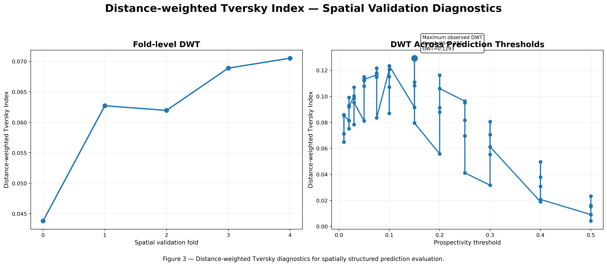

**Figure 1.** Archived GEMS distance-weighted Tversky score visualization.

[Open the score visualization directly](Figures/03_distance_weighted_tversky.png)

---

## 🗺️ Project Overview

The **Geologic Enhanced Mapping System (GEMS)** combines geophysical predictors, machine-learning analysis, and geospatial visualization to generate fault-prospectivity predictions and rank potential exploration targets.

The project is designed to support geological interpretation by highlighting spatial patterns that may be associated with faults and structures relevant to geothermal exploration.

### Project objectives

* Integrate geophysical and topographic predictor data.
* Generate spatially referenced prospectivity predictions.
* Evaluate predictions using conventional classification metrics and distance-weighted Tversky diagnostics.
* Visualize prediction patterns alongside satellite, geological-line, and terrain context.
* Produce ranked exploration targets and reproducible analysis tables.

### Executive dashboard

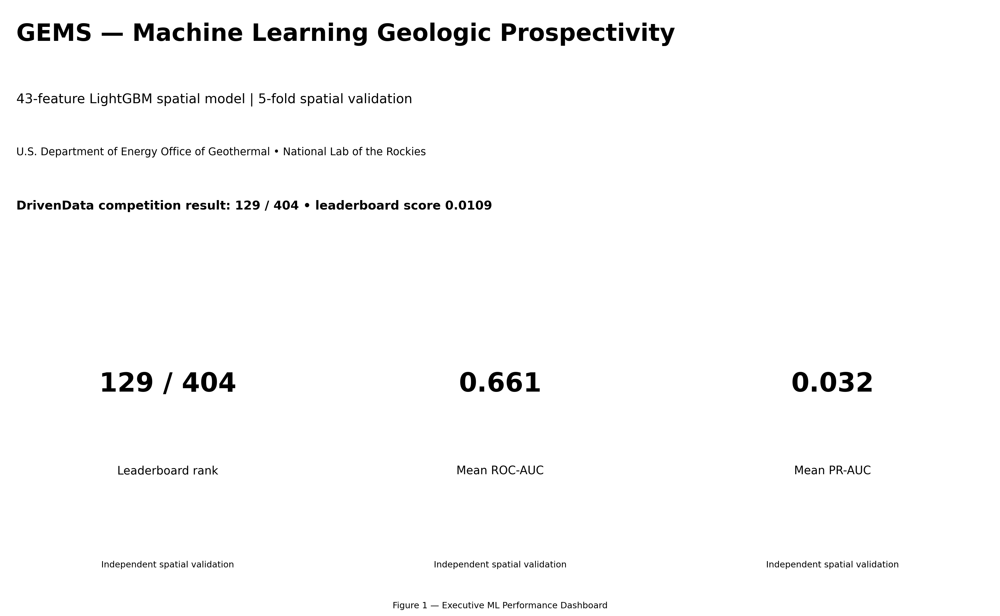

**Figure 2.** GEMS executive dashboard.

[Open the executive dashboard](Figures/01_GEMS_executive_dashboard.png)

---

## 🎯 Tversky Score and Evaluation

The GEMS competition uses a **distance-weighted Tversky index** to evaluate fault predictions. Unlike a strict pixel-by-pixel comparison, distance weighting accounts for the spatial proximity of predictions to reference fault locations.

This matters because rasterization, pixel boundaries, and spatial offsets can cause nearby predictions to be penalized less than predictions far from reference faults.

### Tversky formula

The conventional Tversky index is:

**T(alpha, beta) = TP / (TP + alpha × FP + beta × FN)**

where:

* **TP** is the true-positive contribution.
* **FP** is the false-positive contribution.
* **FN** is the false-negative contribution.
* **alpha** controls the false-positive penalty.
* **beta** controls the false-negative penalty.

For the GEMS competition, the distance tolerance is **300 metres**, with **alpha = 0.2** and **beta = 0.8**. The distance-weighted implementation modifies the contributions based on spatial proximity; it is not simply the conventional unweighted formula above.

### Main Tversky figure

**Figure 3.** Archived distance-weighted Tversky score analysis.

[View or open Figure 3](Figures/03_distance_weighted_tversky.png)

### Tversky heatmap

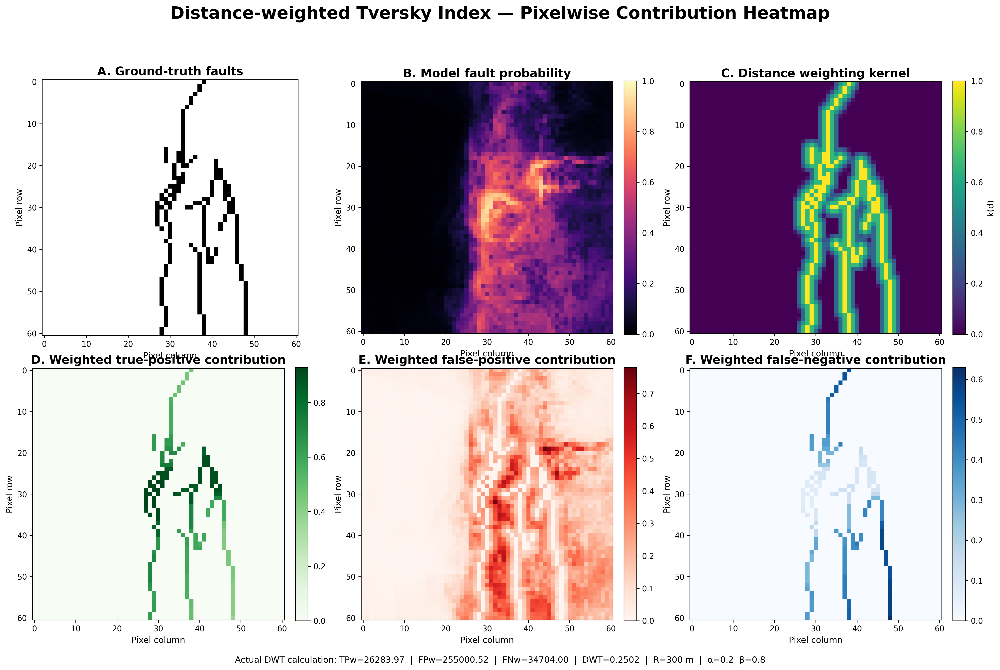

**Figure 4.** Distance-weighted Tversky heatmap.

[View or open Figure 4](Figures/03_distance_weighted_tversky_heatmap.png)

### Spatial Tversky map

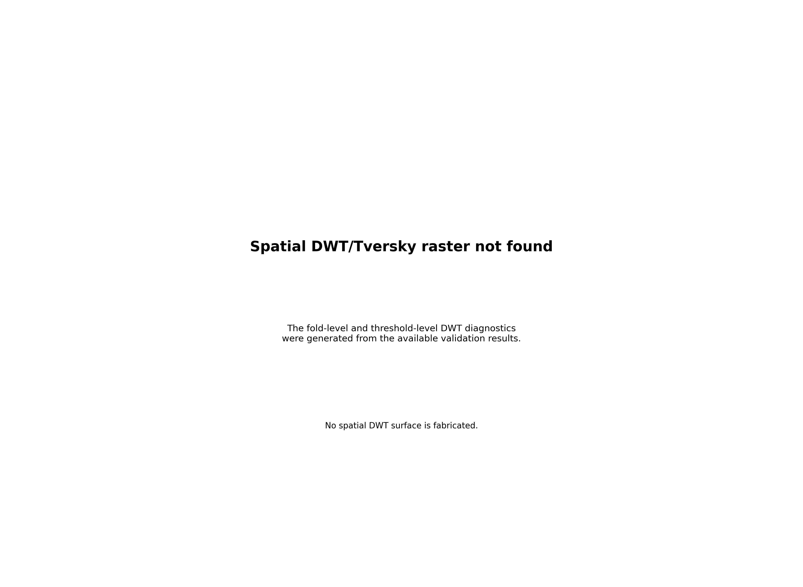

**Figure 5.** Spatial visualization of distance-weighted Tversky evaluation.

[View or open Figure 5](Figures/04_distance_weighted_tversky_map.png)

### Archived weighted contributions

| Diagnostic                                 |      Value |
| ------------------------------------------ | ---------: |
| Weighted true-positive contribution (TPw)  |  26,283.97 |
| Weighted false-positive contribution (FPw) | 255,000.52 |
| Weighted false-negative contribution (FNw) |  34,704.00 |
| Separate archived summary score            |     0.2502 |

The archived values represent distinct diagnostics. The summary value of **0.2502 must not be interpreted as the official competition leaderboard score** unless the corresponding evaluation implementation and submission record confirm that interpretation.

### Evaluation CSV files

* [Distance-weighted Tversky summary](Tables/distance_weighted_tversky_summary.csv)
* [Pixel-level weighted contributions](Tables/dwt_pixel_contributions.csv)
* [Threshold analysis](Tables/threshold_analysis.csv)
* [Model performance metrics](Tables/model_performance.csv)

---

## 🛰️ Prediction Maps

### GEMS prediction map

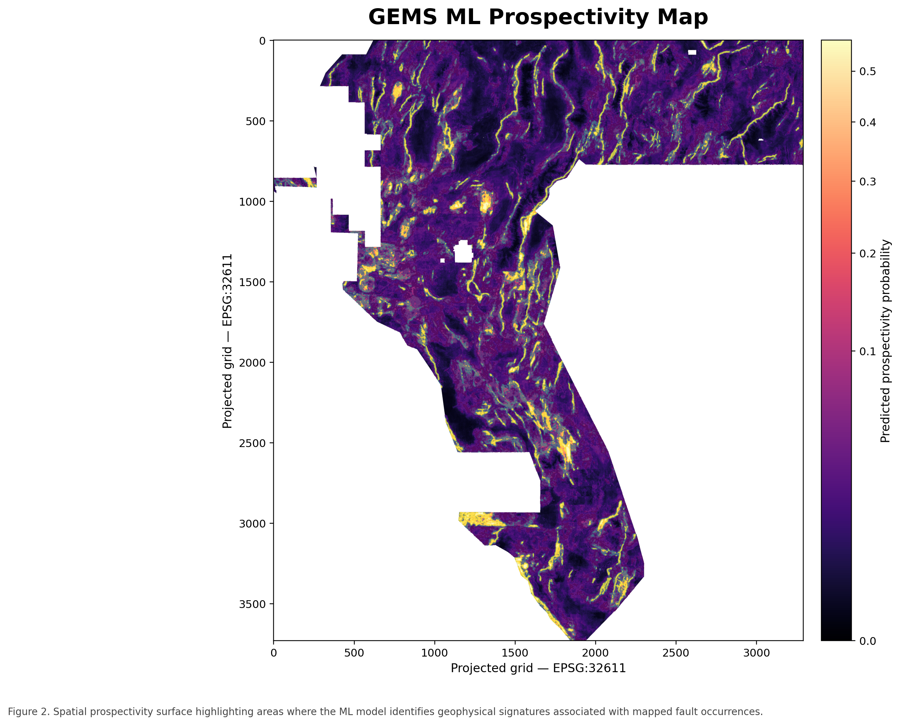

**Figure 6.** GEMS spatial prediction map.

[Open the prediction map](Figures/02_GEMS_prediction_map.png)

### Prospectivity map

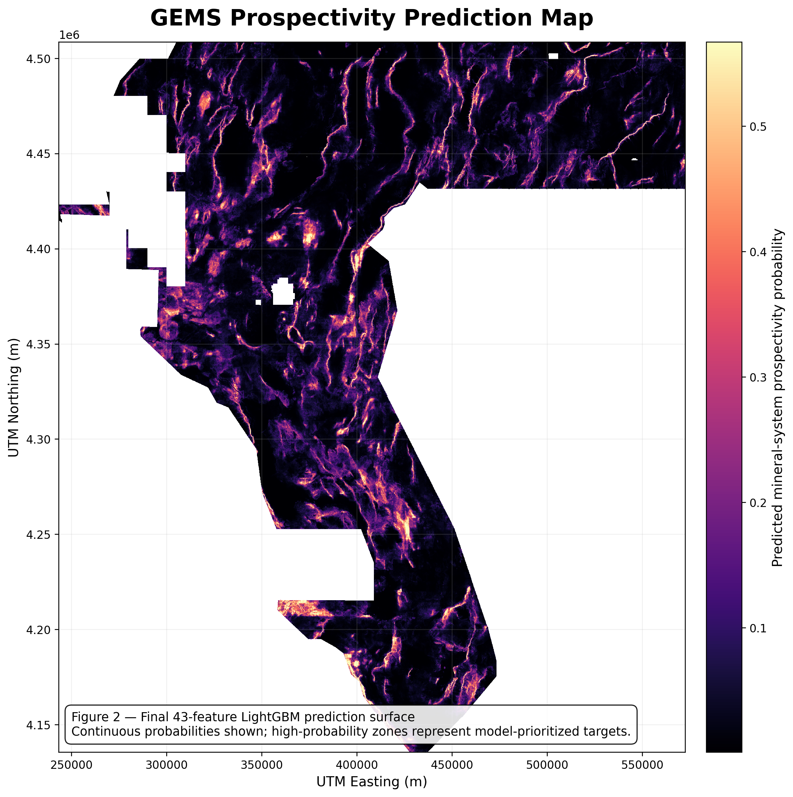

**Figure 7.** Spatial distribution of predicted geological prospectivity.

[Open the prospectivity map](Figures/02_GEMS_prospectivity_map.png)

### Satellite prospectivity overlay

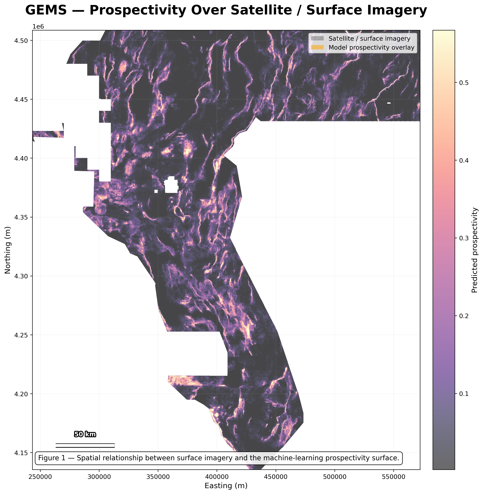

**Figure 8.** Prospectivity predictions displayed with satellite context.

[Open the satellite overlay](Figures/01_satellite_prospectivity_overlay.png)

### Geological line overlay

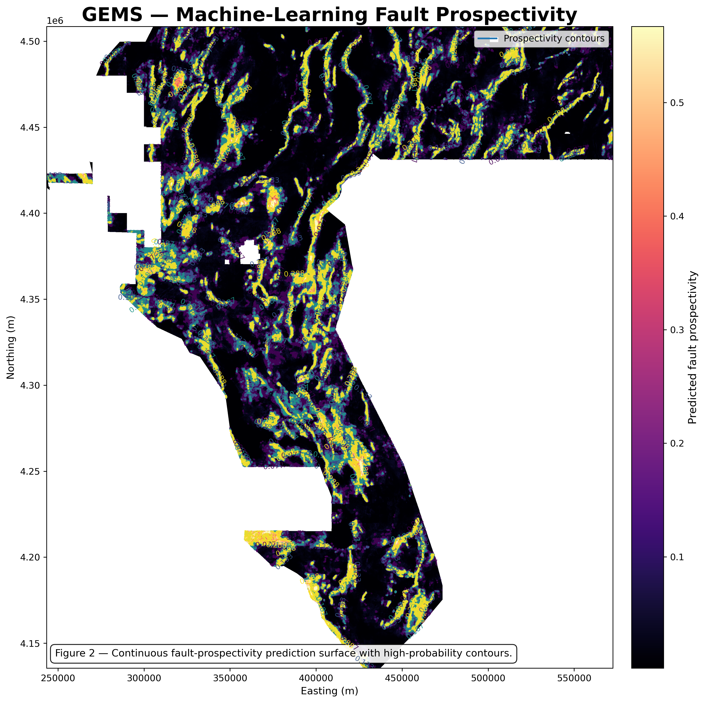

**Figure 9.** Prospectivity patterns with geological-line context.

[Open the geological-line overlay](Figures/02_prospectivity_geologic_lines.png)

### Terrain context

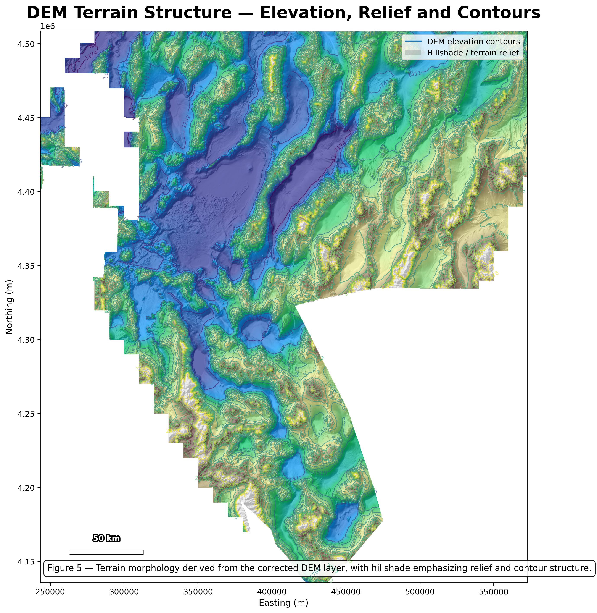

**Figure 10.** Digital elevation model, hillshade, and contours for terrain interpretation.

[Open the DEM hillshade and contours](Figures/05_dem_hillshade_contours.png)

---

## 📍 Exploration Target Ranking

GEMS includes spatial prospectivity outputs and target-ranking artifacts intended to help prioritize areas for additional geological review.

The highest-ranked locations should be interpreted as **model-generated candidate targets**, not as confirmed faults or verified geothermal resources.

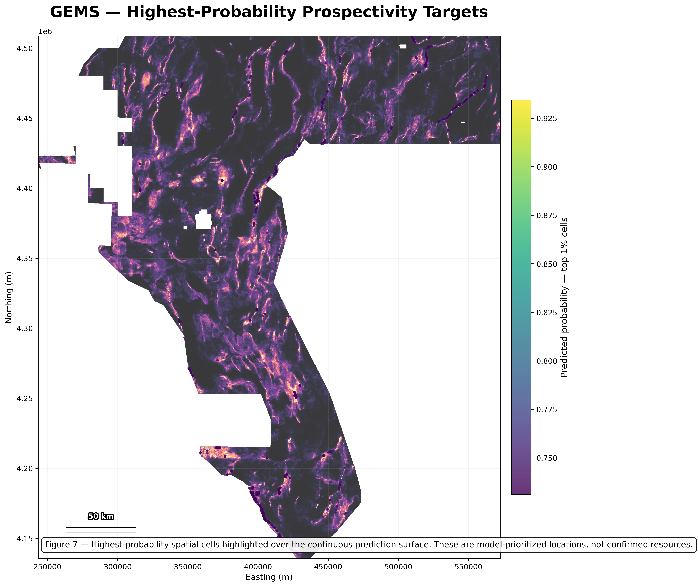

**Figure 11.** Highest-ranked prospectivity targets.

[Open the top-target figure](Figures/07_top_prospectivity_targets.png)

### Target and prediction tables

* [Top 100 prospectivity targets](Tables/top_100_prospectivity_targets.csv)
* [Prospectivity cells](Tables/prospectivity_cells.csv)
* [Prediction summary](Tables/prediction_summary.csv)
* [Portfolio summary](Tables/GEMS_portfolio_summary.csv)

---

## 🧲 Geophysical and Feature Analysis

Geophysical and topographic predictors provide the input context for identifying spatial patterns associated with potential geological structures.

Feature diagnostics can help characterize the model inputs and interpret the spatial behavior of predictions. Feature importance or visual association alone does not establish a causal geological relationship.

### Geophysical signatures

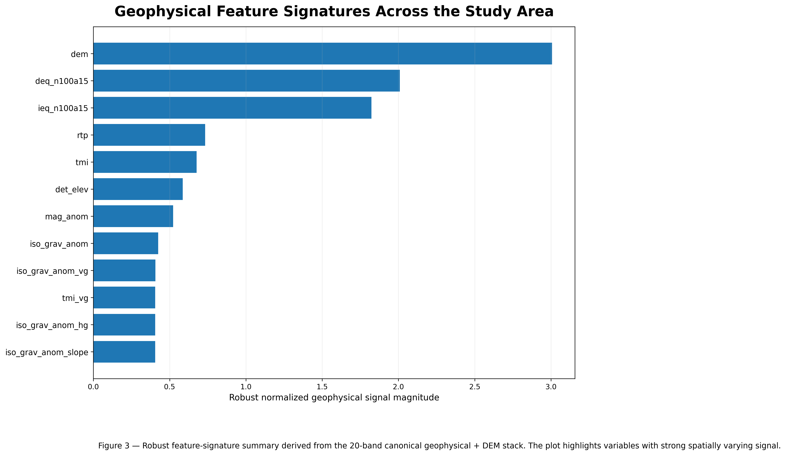

**Figure 12.** Geophysical signatures used in GEMS analysis.

[Open the geophysical signatures figure](Figures/03_GEMS_geophysical_signatures.png)

### Model feature signatures

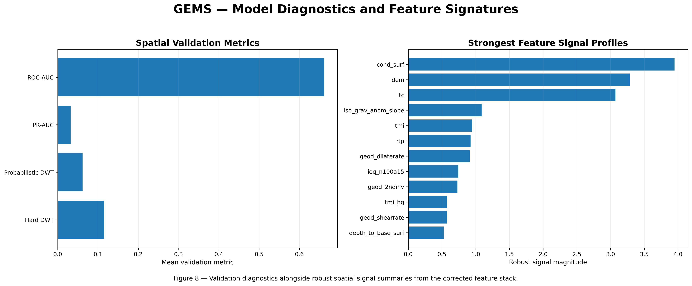

**Figure 13.** Model feature signatures and associated diagnostics.

[Open the feature signatures figure](Figures/08_model_feature_signatures.png)

### Related tables

* [Feature statistics](Tables/feature_statistics.csv)
* [Selected input files](Tables/selected_input_files.csv)
* [Model performance](Tables/model_performance.csv)

---

## 📐 Study Grid and Data

The archived project analysis reports the following spatial characteristics:

| Property                          | Reported value |
| --------------------------------- | -------------- |
| Raster width                      | 3,292 pixels   |
| Raster height                     | 3,730 pixels   |
| Nominal pixel resolution          | 100 m          |
| Coordinate reference system       | EPSG:32611     |
| Reported finite prediction pixels | 4,733,111      |
| Reported prediction coverage      | 38.55%         |
| Number of predictors              | 43             |
| Reported base geophysical bands   | 20             |

The archived prediction summary reports:

| Prediction statistic |    Value |
| -------------------- | -------: |
| Minimum              | 0.000063 |
| Median               |   0.0265 |
| Mean                 |   0.0672 |
| Standard deviation   |   0.1015 |
| Maximum              |   0.9344 |

These are archived project statistics. The values describe the recorded raster and model outputs; they do not independently establish the accuracy of every predicted fault.

---

## 📁 Data and Figures

### Figures

All image paths below are relative to the repository root. GitHub paths are case-sensitive, so the folder name must match `Figures` exactly.

| Figure                                                                                       | Description                     |
| -------------------------------------------------------------------------------------------- | ------------------------------- |
| [01_GEMS_executive_dashboard.png](Figures/01_GEMS_executive_dashboard.png)                   | Executive dashboard             |
| [01_satellite_prospectivity_overlay.png](Figures/01_satellite_prospectivity_overlay.png)     | Satellite prospectivity overlay |
| [02_GEMS_prediction_map.png](Figures/02_GEMS_prediction_map.png)                             | Prediction map                  |
| [02_GEMS_prospectivity_map.png](Figures/02_GEMS_prospectivity_map.png)                       | Prospectivity map               |
| [02_prospectivity_geologic_lines.png](Figures/02_prospectivity_geologic_lines.png)           | Geological-line overlay         |
| [03_GEMS_geophysical_signatures.png](Figures/03_GEMS_geophysical_signatures.png)             | Geophysical signatures          |
| [03_distance_weighted_tversky.png](Figures/03_distance_weighted_tversky.png)                 | Tversky score visualization     |
| [03_distance_weighted_tversky_heatmap.png](Figures/03_distance_weighted_tversky_heatmap.png) | Tversky heatmap                 |
| [04_distance_weighted_tversky_map.png](Figures/04_distance_weighted_tversky_map.png)         | Spatial Tversky map             |
| [05_dem_hillshade_contours.png](Figures/05_dem_hillshade_contours.png)                       | DEM hillshade and contours      |
| [07_top_prospectivity_targets.png](Figures/07_top_prospectivity_targets.png)                 | Ranked exploration targets      |
| [08_model_feature_signatures.png](Figures/08_model_feature_signatures.png)                   | Feature signatures              |

### CSV tables

| File                                                                                  | Purpose                              |
| ------------------------------------------------------------------------------------- | ------------------------------------ |
| [GEMS_portfolio_summary.csv](Tables/GEMS_portfolio_summary.csv)                       | Archived portfolio-level summary     |
| [distance_weighted_tversky_summary.csv](Tables/distance_weighted_tversky_summary.csv) | Tversky evaluation summary           |
| [dwt_pixel_contributions.csv](Tables/dwt_pixel_contributions.csv)                     | Pixel-level weighted contributions   |
| [feature_statistics.csv](Tables/feature_statistics.csv)                               | Feature statistics                   |
| [model_performance.csv](Tables/model_performance.csv)                                 | Model performance metrics            |
| [prediction_summary.csv](Tables/prediction_summary.csv)                               | Prediction distribution and coverage |
| [prospectivity_cells.csv](Tables/prospectivity_cells.csv)                             | Prospectivity-cell records           |
| [selected_input_files.csv](Tables/selected_input_files.csv)                           | Selected input file inventory        |
| [threshold_analysis.csv](Tables/threshold_analysis.csv)                               | Threshold diagnostics                |
| [top_100_prospectivity_targets.csv](Tables/top_100_prospectivity_targets.csv)         | Ranked prospectivity targets         |

---

## 🧪 Methodology

The GEMS workflow represented by this repository consists of the following broad stages:

1. **Input preparation:** collect and organize geophysical, terrain, and related predictor data.
2. **Spatial processing:** align inputs to the analysis grid and preserve spatial referencing.
3. **Feature preparation:** organize the predictor variables for model analysis.
4. **Prediction generation:** produce spatially referenced prospectivity outputs.
5. **Evaluation:** calculate and record model diagnostics, threshold analyses, and distance-weighted Tversky measures.
6. **Visualization:** generate maps, overlays, score diagnostics, and feature figures.
7. **Target prioritization:** export ranked prospectivity targets for further interpretation.

For exact implementation details, parameters, and reproducibility, consult the project's source code and archived CSV outputs.

---

## ⚠️ Limitations and Interpretation

* Model predictions identify candidate locations and require geological review.
* ROC-AUC and PR-AUC are not interchangeable with the competition's distance-weighted Tversky score.
* Probabilistic Tversky, best-hard Tversky, and a separate archived summary value are different diagnostics and should be reported separately.
* Threshold choices affect binary predictions and can change evaluation results.
* Spatial proximity weighting does not eliminate the need to validate predictions against the official scoring implementation.
* Prediction maps and target rankings should not be interpreted as confirmed discoveries.
* The official leaderboard score and rank should be reported directly from the competition platform, not inferred from local evaluation files.

---

## 🔁 Reproducibility

The repository includes archived visualizations and CSV summaries to support review of the reported results.

For a reproducible run, record:

* The exact input datasets and versions.
* Coordinate reference system, raster dimensions, and pixel resolution.
* Feature preprocessing and model configuration.
* Prediction-generation settings and any thresholding.
* The exact evaluation implementation and parameters.
* The generated submission artifact and its validation results.
* The official competition score and rank, when available.

---

## 🔗 Links

* **GitHub repository:** [ut1776/GeologicEnhancedMap](https://github.com/ut1776/GeologicEnhancedMap)
* **Official GEMS competition:** [DrivenData — GEMS Prize Challenge](https://www.drivendata.org/competitions/306/)
* **Competition metric and description:** [GEMS competition details](https://www.drivendata.org/competitions/306/competition-doe-gems/page/967/)

---

### 🌋 Geologic Enhanced Mapping System

**Geophysical data · Machine learning · Spatial prospectivity · Fault-target evaluation**

*Supporting data-driven geological interpretation and geothermal exploration.*

---

## 🧭 Geological Concepts: Read the Map Before Reading the Model

GEMS is a **geospatial prospectivity workflow**. Its outputs are best understood by connecting the model to the geological processes and measurements that motivate exploration.

### 1. What is a geological fault?

A fault is a fracture or zone of fractures in rock along which blocks have moved relative to one another. Faults can create pathways for fluids, juxtapose different rock units, and influence permeability. In geothermal settings, faults and fracture networks may help hot fluids circulate—but not every fault is permeable, active, or associated with a usable geothermal system.

### 2. What is geothermal prospectivity?

A geothermal system generally requires a heat source, fluids, and permeable pathways or reservoir rocks, commonly beneath a suitable cap rock. Exploration therefore combines several kinds of evidence: regional geology, structural interpretation, geochemistry, temperature information, and geophysical measurements.

A prospectivity map combines selected evidence to highlight areas that may deserve further investigation. It is a prioritization aid, not a direct measurement of underground temperature, permeability, or commercial viability.

### 3. What do geophysical measurements tell us?

Geophysical methods infer subsurface properties from measurements made at or near the surface. Different methods respond to different physical properties:

| Method / data family | Main physical sensitivity | Common geological use |
|---|---|---|
| Magnetic | Variations in magnetic susceptibility and remanent magnetization | Mapping lithology, intrusions, and structural trends |
| Gravity | Variations in subsurface density | Identifying density contrasts, basins, and larger structures |
| Electrical resistivity / electromagnetic | How strongly materials oppose or conduct electrical current | Investigating fluids, alteration, clay-rich zones, and rock properties |
| Topography / DEM | Surface elevation and landform geometry | Terrain context, drainage, lineament interpretation, and spatial derivatives |
| Remote sensing | Surface reflectance and spectral response | Mapping exposed lithology, alteration indicators, and land cover |

These methods are complementary, not interchangeable. A magnetic anomaly is not itself a fault; a low-resistivity zone is not automatically a geothermal reservoir. Interpretation depends on geology, scale, data quality, and independent evidence.

### 4. From measurements to a spatial prediction

The archived GEMS analysis reports a 100 m nominal grid, EPSG:32611, and 43 predictors. Conceptually, spatial predictors are aligned to a common grid, transformed into model-ready features, and used to produce a score for each eligible cell. The score represents the model's relative prediction under its training and evaluation setup—not a probability of drilling success unless it has been calibrated and validated for that meaning.

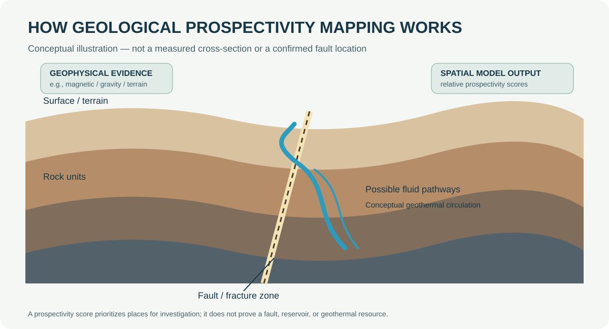

**Figure 14.** Conceptual illustration of geological structures, possible fluid pathways, geophysical evidence, and spatial model output. It is explanatory, not a site-specific geological interpretation.

### 5. How to interpret the distance-weighted Tversky metric

The conventional Tversky index is:

`T = TP / (TP + α·FP + β·FN)`

Here, α controls the false-positive penalty and β controls the false-negative penalty. With α = 0.2 and β = 0.8, missed reference features carry a larger nominal penalty than extra predicted features, before considering the competition's distance-weighting procedure.

The archived analysis uses a 300 m distance tolerance. Distance weighting is important for line-like geological targets because a predicted trace slightly offset from a reference trace may still be spatially relevant. The exact official score must nevertheless be calculated with the competition's official implementation and data protocol.

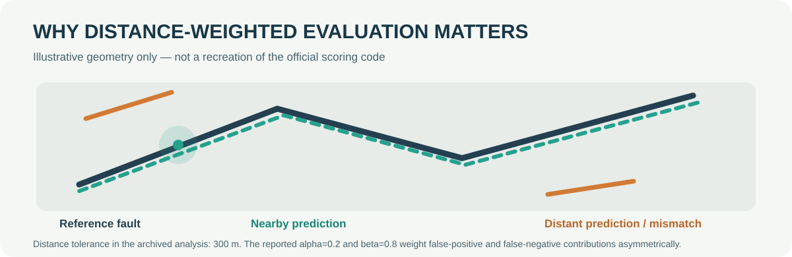

**Figure 15.** Conceptual explanation of near and distant prediction errors. Geometry is illustrative and does not reproduce the official scoring implementation.

### 6. Important distinctions

- **Fault mapping is not earthquake prediction.** This project does not forecast earthquakes or estimate seismic hazard.
- **Prospectivity is not discovery.** A high-scoring cell is a candidate for follow-up, not proof of a geothermal resource.
- **Correlation is not causation.** Feature importance and spatial association do not establish a geological mechanism.
- **Resolution is not accuracy.** A 100 m grid describes the nominal cell spacing; it does not mean the subsurface is known to 100 m precision.
- **Validation must respect geography.** Randomly splitting neighboring pixels can overstate generalization because nearby cells may share spatial structure. Spatially separated validation is an important next step.

### Suggested reading

- [USGS — Geologic Faults](https://www.usgs.gov/programs/earthquake-hazards/faults)
- [USGS — Geophysical Methods](https://www.usgs.gov/centers/geomagnetism/science)
- [NREL — Geothermal Basics](https://www.nrel.gov/research/re-geothermal.html)
- [DrivenData — GEMS Prize Challenge](https://www.drivendata.org/competitions/306/)

